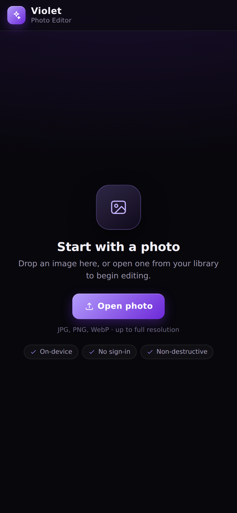
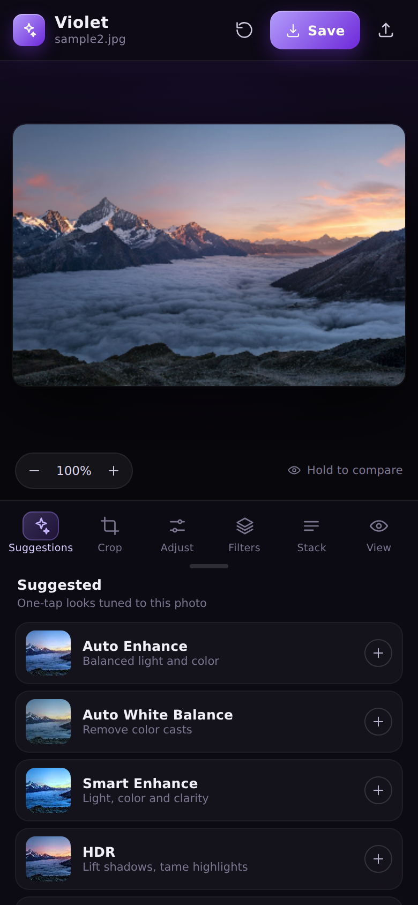
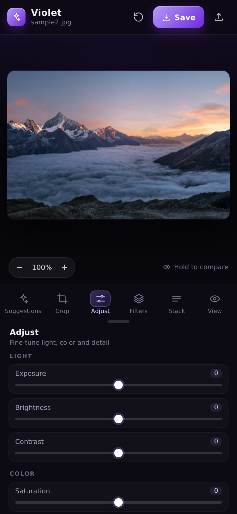
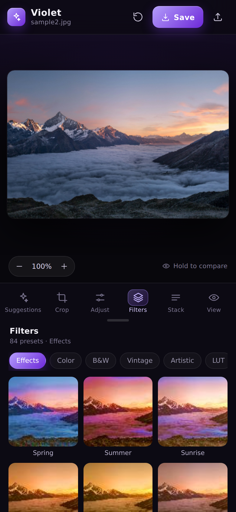
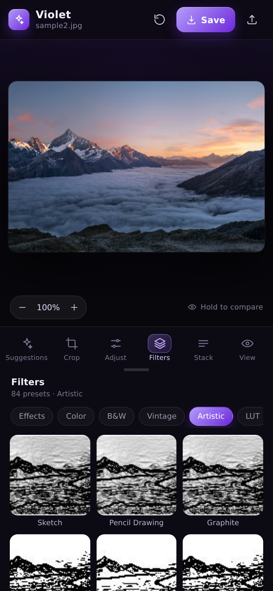
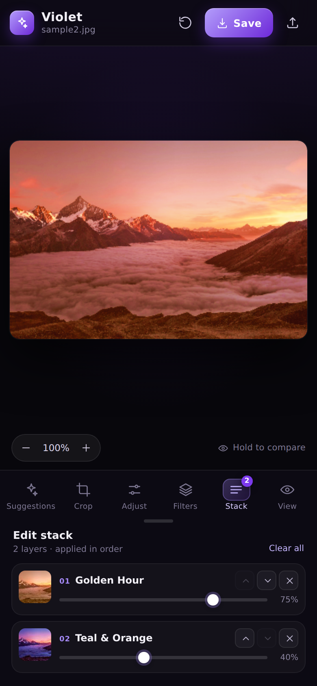
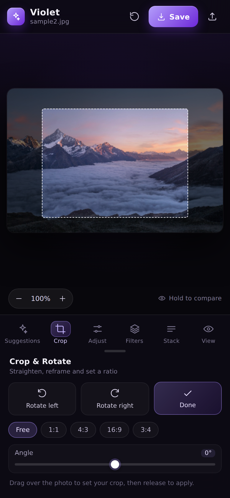
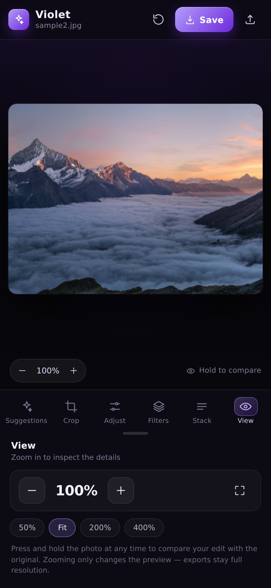

<p align="center">
  
</p>

<h1 align="center">Violet Photo Editor</h1>

<p align="center">
  <strong>Professional photo editing, entirely on your phone.</strong><br />
  Auto enhance, 84 stackable presets, precision adjustments and artistic effects.<br />
  No account. No cloud. No compromises.
</p>

<p align="center">
  <a href="https://github.com/MidnightRaven9/violet-photo-editor/releases/latest"></a>
</p>

<p align="center">
  <a href="https://github.com/MidnightRaven9/violet-photo-editor/releases"></a>
  
  
  
</p>

---

## Screenshots

<p align="center">
  
  &nbsp;
  
  &nbsp;
  
  &nbsp;
  
</p>

<p align="center">
  
  &nbsp;
  
  &nbsp;
  
  &nbsp;
  
</p>

## Highlights

- **Auto Enhance & Auto White Balance** — analyze the photo and apply a natural, balanced correction in one tap.
- **84 presets in six collections** — Effects, Color, B&W, Vintage, LUT and Artistic.
- **Non-destructive stacking** — combine as many looks as you like, tune each layer's strength from 0–100%, and reorder or remove layers at any time.
- **Artistic engine** — sketch, pencil, ink, XDoG, toon, halftone, oil painting, watercolor, mosaic, thermal, Warhol, neon and negative.
- **Precision controls** — exposure, brightness, contrast, saturation, vibrance, warmth, tint, hue, sharpness, clarity, denoise, soften and posterize.
- **Crop & geometry** — free-form crop, 1:1, 4:3, 16:9, 3:4 ratios, 90° rotation and a fine angle slider.
- **Hold to compare** — press and hold the photo anywhere to see the original.
- **Full-resolution export** — saves directly to `Pictures/Violet` on Android; downloads a PNG in the browser.

Everything is processed locally with Canvas and `ImageData`. Photos never leave the device, and the app works completely offline.

## Install on Android

1. Download the latest APK from [Releases](https://github.com/MidnightRaven9/violet-photo-editor/releases/latest).
2. Open the file on your phone and allow "Install unknown apps" for your browser or file manager if prompted.
3. Launch **Violet Photo Editor**, tap **Open photo**, and start editing.

The APK is self-signed, so Android Play Protect may ask for confirmation before installing. That is expected for apps distributed outside the Play Store.

**Requirements:** Android 10 (API 29) or newer.

## Build from source

### Web app

```bash
npm install
npm run dev      # http://127.0.0.1:5173
npm run build    # single-file production build in dist/
```

### Android APK

The Android shell is a minimal WebView activity built without Gradle, using `aapt2`, `javac`, `d8` and `apksigner`.

Requirements:

- JDK 17
- Android SDK platform `android-34`
- Android build-tools `34.0.0`
- ARM hosts: distribution builds of `aapt2`, `zipalign` and `apksigner` (the script picks them up from `PATH`)

```bash
ANDROID_HOME=/opt/android-sdk ./android/build-apk.sh
```

The signed APK is written to `android/build/violet-photo-editor.apk`. Optional environment variables:

| Variable | Purpose | Default |
| --- | --- | --- |
| `VERSION_CODE` | Android version code | `1` |
| `VERSION_NAME` | Android version name | `1.0.0` |
| `VIOLET_KEYSTORE` | Signing keystore path | `android/violet.keystore` |
| `VIOLET_STOREPASS` | Keystore password | `violet-photo-editor` |
| `VIOLET_KEY_ALIAS` | Key alias | `violet` |

The build script bundles the Vite output into `assets/www`, compiles resources and Java, dexes, aligns and signs the APK. On first run it generates a local signing key; keystores and build outputs are gitignored.

## Architecture

```text
photo-editor/
├── src/
│   ├── App.jsx         # Editor state, preview pipeline, export bridge, UI
│   ├── process.js      # Pixel pipeline, color math, filters, artistic effects
│   ├── icons.jsx       # Inline SVG icon set
│   ├── styles.css      # Violet design system
│   └── main.jsx        # React entry point
├── android/
│   ├── app/src/main/   # Manifest, WebView activity, resources, launcher icons
│   └── build-apk.sh    # Gradle-free APK build and signing
├── scripts/shots.mjs   # Playwright screenshot generator
├── docs/screenshots/   # README screenshots
└── vite.config.js      # Single-file bundle for the WebView
```

**Preview pipeline.** The photo is decoded once, rotated and cropped on a canvas, then downscaled to fit the screen for interactive editing. Filters and adjustments are applied to `ImageData` and blended per layer strength. Export repeats the same pipeline at full resolution.

**Android bridge.** The WebView hosts the single-file bundle from `assets/www/index.html`. A small JavaScript interface (`window.Violet.saveImage`) writes JPEGs into the system gallery through `MediaStore`, so the edited photo appears in `Pictures/Violet` without any storage permission.

**Privacy.** There are no network requests, analytics, accounts or uploads. The Android manifest requests no permissions.

## Development notes

Regenerate the screenshots while the dev server is running:

```bash
npm run dev
npm run shots
```

Screenshots use a mountain photo from [Unsplash](https://unsplash.com).

## License

MIT © 2026 MidnightRaven9. See [LICENSE](LICENSE).
